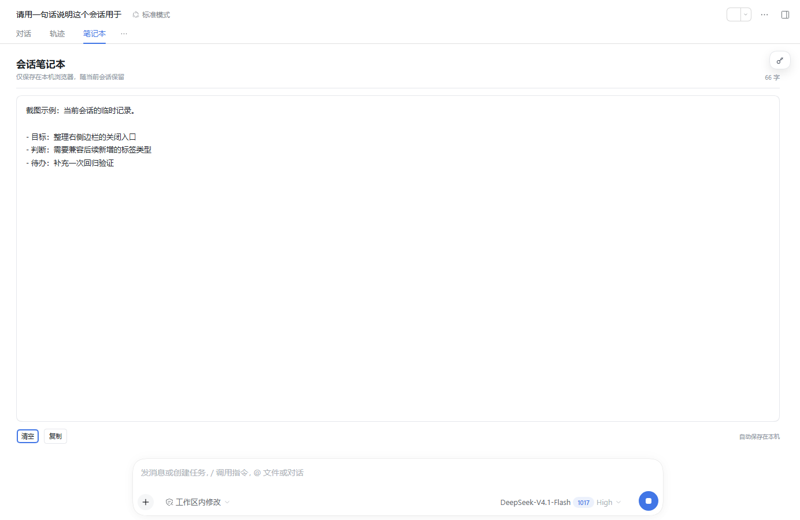
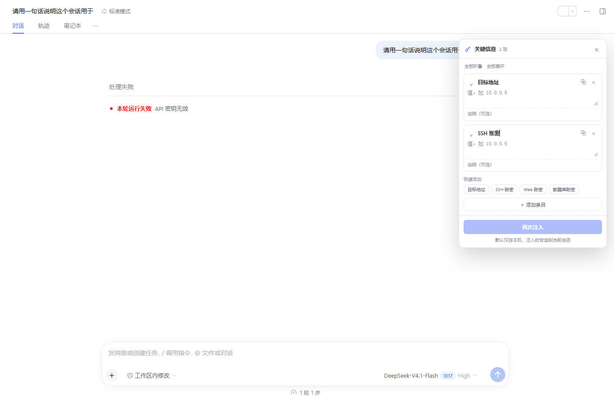

# dsh-handy

A DeepSeek Harness Web plugin that adds per-session notes, a draggable key-information panel, turn-level forks with notebook/key-information inheritance, workspace-scoped session groups, session highlighting, running-workspace prioritization, and bulk close actions for every right-sidebar tab.

[中文](README.md)

## Features

- **Per-session notebook** — a `对话 / 轨迹 / 笔记本` view with auto-saved local notes.
- **Key-information panel** — a draggable per-session panel for targets, SSH/Web/database credentials, and free-form notes. It stays inside the conversation column, follows the column when the right sidebar opens, supports per-item injection, and keeps inject/copy/delete actions visible when an item is collapsed. The collapsed badge can be right-dragged.
- **Fork inheritance** — native fork and `/fork` copy the source session's notebook and key information, including collapsed-item and panel-position state.
- **Workspace session groups** — logical folders under a workspace, with up to three levels of nesting and drag-to-group support.
- **Session highlighting** — star important sessions from the row or the row menu.
- **Running-workspace priority** — workspaces with a running session or running subagent move to the top and use a blue running spinner.
- **Right-sidebar tab bulk close** — close current, left, right, or all tabs for every tab kind; the dock's built-in close menu row is hidden in favor of the plugin action.

## Feature details

### Per-session notebook

The notebook is a third conversation view tab next to the conversation and trajectory views. Every session has its own text area. Edits are saved locally after roughly 250 ms, flushed on blur and view changes, and restored after a reload. The view includes a character count, copy, and clear actions. Notes are browser-local and are not sent to the model unless you do so yourself.

### Key-information panel

The key-information panel is hidden behind a key badge in the session header. It stores name/value/note items for targets, SSH, web, and database credentials, plus arbitrary custom items. Items can be collapsed individually or all at once; a collapsed item keeps its inject, copy, and delete actions. Each item has its own inject action, while the footer still injects all items with values.

The expanded panel can be dragged from its header. When collapsed, the badge can be right-dragged to move within the conversation column. Position is remembered per session, follows the column when the right sidebar opens, and resets on title double-click.

Per-item or footer injection sends the selected item(s) and notes to the end of the current session queue; empty values are skipped. If another DSH process owns the session write handle, injection reports that the session is in use instead of failing silently. Values are plain local storage data and are only sent when you click inject.

### Fork inheritance

`/fork` lists user turns from the loaded history and creates a child at the selected boundary. The native Fork action and `/fork` both copy the source notebook and key-information state into the child, including item collapsed state and panel position. Workspace membership, groups, highlight stars, and model settings are not copied. A running turn is cut at its current boundary by the host.

### Workspace session groups

Groups are logical folders under one workspace, not real directories. They support up to three nesting levels, adding sessions, starting sessions inside a group, and dragging session cards onto a group. Groups and membership stay in local browser state and are rejected when they would cross workspaces.

### Session highlighting

A row star or the row menu's "mark as important" action adds a colored gradient surface and left edge bar to a session. The state is local and synchronized between browser windows. It does not alter session content or archive status.

### Running workspace priority

A workspace containing a running session or a running subagent of one of its sessions is promoted to the top of the sidebar. Multiple running workspaces keep the host's relative order, and the normal host order returns when the runs finish. The running spinner is blue with a small glow; this is a display change only.

### Right-sidebar tab close

Right-click any dock tab for close current, close left, close right, or close all. The actions are attached to the dock tab menu rather than to a file-only path, so file, preview, terminal, and future dock tab kinds use the same actions. The dock's built-in close menu row is hidden to avoid two close-current entries; the tab's own X control remains available.

## Screenshots





## Install

The npm package is not published yet. Install from GitHub:

```powershell
dsh plugin --profile desktop add https://github.com/dayutech/dsh-handy
```

Or from a local checkout:

```powershell
dsh plugin --profile desktop add D:\path\to\dsh-handy
```

Restart the matching DSH process and refresh the Web page.

## Compatibility

- DSH Web client.
- `engines.dsh`: `>=0.2.1-rc.3 <0.2.2-0`; verified on DSH `0.2.1-rc.5`.
- Host half: `dsh.bundle.patch`; browser half: `dsh.client.platform: "web"`.

## Data and security

- Notebook and key information are stored in the browser's `localStorage` under `dsh.handy.v1`.
- Key-information values are **plain text** and may contain credentials. Do not use a shared browser profile for secrets.
- "Inject again" sends the values as a user message into the current session; only do this in an environment allowed to handle them.
- Fork inheritance wraps `sessions.fork` to copy local notebook/key-information state into the child session.
- The plugin does not send this local state over its own network requests.

## Development

```powershell
npm install
npm run build
npm run check
npm run pack:dry
```

Market metadata and the upstream submission draft live in `market/dayutech__dsh-handy.yml`. Follow the [awesome-dsh-plugin contribution rules](https://github.com/awesome-dsh-plugin/awesome-dsh-plugin/blob/main/contributing.md) when submitting.

## License

MIT
