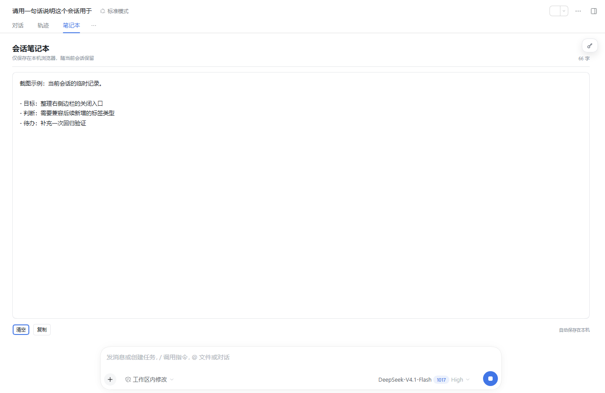
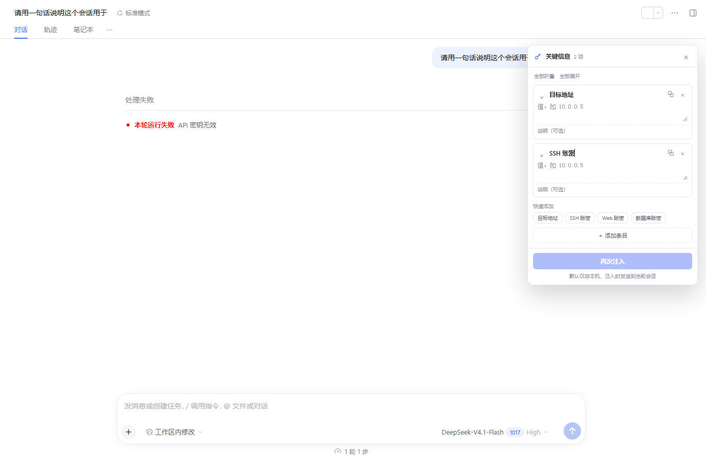

# dsh-handy · 便捷使用

dsh-handy 是一个 DeepSeek Harness Web 增强插件，集中提供会话笔记本、可拖动关键信息面板、指定轮次分叉与分叉继承、工作区会话组、会话高亮、运行工作区置顶，以及右侧边栏任意标签的批量关闭。笔记本、星标、会话组与关键信息默认只保存在本机浏览器；只有点击「再次注入」时，关键信息才会进入当前会话上下文。

[English](README.en.md)

## 功能

| 功能 | 入口 | 说明 |
| --- | --- | --- |
| 指定轮次分叉 | 对话框输入 `/fork` | 弹出当前会话的用户轮次；选一轮后从该轮之后创建分支，并自动打开新分支 |
| 分叉继承 | 任意分叉入口 | 分叉出的新会话自动继承原会话的笔记本内容与关键信息（包括条目折叠状态和面板位置）；原生分叉与 `/fork` 都支持 |
| 右侧边栏标签快速关闭 | 右键任意右侧边栏标签 | 关闭当前、关闭左侧所有、关闭右侧所有、关闭所有；对文件、预览及后续新增的标签类型统一生效；系统自带的「关闭」菜单项已由插件「关闭当前」取代 |
| 会话组 | 工作区行 `…` →「新增会话组」；会话组行 `…`；会话行菜单「加入会话组…」 | 在工作区下显示逻辑子文件夹；组内可添加会话、新建会话；支持最多 3 级嵌套；组与会话均限定在同一工作区；可把会话卡片拖到会话组上移动 |
| 会话高亮 | 会话行右侧星标，或会话行菜单「标记为重要」 | 重要会话在左侧列表中带彩色渐变底和左侧色条，方便扫视 |
| 会话笔记本 | 会话顶部「对话 / 轨迹 / 笔记本」中的「笔记本」 | 每个会话独立的本机文本记录区，自动保存，可复制或清空 |
| 关键信息 | 会话右侧悬浮栏；隐藏时点击右上角钥匙徽标展开 | 以键值对管理目标地址、SSH/Web/数据库账密等；悬浮栏可拖动、会跟随会话工作区并在右侧边栏展开时自动左移；每个条目可折叠，折叠后仍显示注入/复制/删除；支持单条注入或「再次注入」全部；收起后的徽标支持右键拖动 |
| 运行状态排序 | 自动生效 | 有会话或子 agent 正在运行的工作区自动提升到最上方；运行会话的转圈指示改为更醒目的蓝色 |

## 功能详解

### 1. 会话笔记本

- 入口：会话顶部「对话 / 轨迹 / 笔记本」中的「笔记本」标签。
- 每个会话有独立的文本区，不会与其他会话串内容。
- 输入后约 250ms 自动保存；失焦、切换标签或离开页面时也会刷新保存。
- 刷新页面、重新打开会话后恢复；同一浏览器不同标签页会同步。
- 提供字数统计、复制全文和清空当前会话笔记。
- 数据只在本机，不跨设备同步，也不会自动发送给模型。

### 2. 关键信息悬浮栏

- 入口：会话页右上角的钥匙徽标；默认收起，有内容时徽标显示条目数。
- 用途：集中记录目标地址、SSH 账密、Web 登录信息、数据库连接信息，以及自定义键值对。
- 每个条目包含「名称 / 值 / 说明（可选）」，支持复制值、删除条目。
- 快速添加预设：目标地址、SSH 账密、Web 账密、数据库账密；也可以添加任意自定义条目。
- 每个条目可单独折叠；折叠后只显示名称，但仍保留单条注入、复制和删除按钮。
- 每个条目都有独立的「注入此条」按钮，只发送当前条目；底部「再次注入」仍会发送全部有值条目。
- 面板顶部提供「全部折叠 / 全部展开」。
- 展开面板可拖动标题移动；收起为钥匙徽标后，可以按住鼠标右键拖动徽标移动。
- 悬浮栏位置按会话保存，并限制在当前会话工作区内。
- 右侧边栏打开时会话区收窄，悬浮栏会跟随工作区右边界向左移动；双击标题可恢复默认位置。
- 点击「再次注入」时，会把所有已填写值的条目连同用途说明发送到当前会话队列末尾；没有填写值的条目不会发送。
- 如果当前会话被另一个 DSH 进程占用，注入会提示会话正被占用；这是宿主写入句柄限制，不是静默失败。
- 关键信息是明文本地数据；它只在点击注入时进入会话，插件本身不会把它上传到其他服务。

### 3. 指定轮次分叉与分叉继承

- 入口：对话框输入 `/fork`，或使用 DSH 原生的「分叉会话」。
- `/fork` 会列出当前会话已加载历史中的用户轮次；可以选择从某一轮之后建立分支，并自动打开新会话。
- 完整轮次从该轮回复之后分叉；仍在进行中的轮次从当前进度分叉，由宿主补齐未闭合的工具调用。
- 原生分叉和 `/fork` 都会把源会话的笔记本与关键信息复制到新会话。
- 复制内容包括关键信息条目、值、说明、条目折叠状态和悬浮栏位置；不会复制工作区归属、会话组、高亮星标或模型设置。
- 分叉继承的是本机保存的 `dsh.handy.v1` 状态；如果源会话尚未自动保存刚输入的笔记本内容，可能只复制最近一次已保存内容。

### 4. 工作区会话组

- 入口：工作区行的 `…` 菜单新增会话组；会话组行的 `…` 菜单管理组；会话行菜单的「加入会话组…」移动会话。
- 会话组是工作区下的逻辑子文件夹，不是真实文件系统目录。
- 支持最多 3 级嵌套；组与会话必须属于同一个工作区。
- 可以在组内添加会话、新建会话，也可以把会话卡片拖到会话组上移动。
- 组和归属关系保存在本机 `localStorage`，不会写入 Host 会话日志。
- 不同工作区之间的拖拽会被拒绝并给出提示。

### 5. 会话高亮

- 入口：会话行右侧星标，或会话行菜单「标记为重要」。
- 重要会话显示彩色渐变底和左侧色条，便于在长列表中扫视。
- 高亮状态按会话保存在本机，并支持跨窗口同步；不会改变会话内容或归档状态。

### 6. 运行工作区排序与蓝色运行指示

- 有会话正在运行，或该会话有子 agent 正在运行的工作区，会自动提升到侧边栏最上方；多个运行工作区按 Host 原始顺序稳定排列。
- 任务结束后按 Host 工作区顺序恢复，不会永久打乱工作区。
- 正在运行的会话前方转圈使用蓝色并带轻微蓝色光晕，和空闲/完成状态区分更明显。
- 只调整 Web 侧边栏的显示顺序和状态颜色，不修改会话状态或工作区数据。

### 7. 右侧边栏标签批量关闭

- 入口：右键任意右侧边栏标签，选择「关闭当前标签页」「关闭左侧所有标签页」「关闭右侧所有标签页」或「关闭所有标签页」。
- 对文件、预览、终端以及后续新增的 dock 标签类型统一生效，不依赖标签内容类型。
- 系统自带的菜单项「关闭」已隐藏，避免与插件「关闭当前标签页」重复；标签上的单独 X 按钮仍保留。
- 关闭操作通过右侧边栏控制器执行，仍遵循宿主对当前可关闭标签的判断。

## 截图





## 安装

当前版本尚未发布到 npm，直接从 GitHub 安装：

```powershell
dsh plugin --profile desktop add https://github.com/dayutech/dsh-handy
```

从本地目录安装：

```powershell
dsh plugin --profile desktop add D:\path\to\dsh-handy
```

如果使用 CLI profile，把 `desktop` 换成实际 profile 名。安装后重启对应的 Harness 进程并刷新页面。

> npm 包发布后，可以把上面的 GitHub 地址换成 `dsh-handy`；在发布前请不要使用 `dsh plugin add dsh-handy`，该名称目前仍返回 404。

也可以在 `~/.dsh/profiles/<profile>/package.json` 中把本包加入依赖，并确保 `dsh.profile.bundles` 包含 `dsh-handy`。

## 兼容性

- 运行平台：DSH Web 客户端。
- 插件包声明 `engines.dsh`：`>=0.2.1-rc.3 <0.2.2-0`。
- 当前在 DSH `0.2.1-rc.5` 上构建和验证。
- 通过 `dsh.bundle.patch` 挂载 Host 半部分；浏览器半部分由 `dsh.client.platform: "web"` 和 `dsh.client.inject` 声明。
- 不依赖额外 npm 运行时包；官方 DSH 客户端包由宿主提供。

## 数据与安全

- 笔记本和关键信息保存在本机 `localStorage` 的 `dsh.handy.v1` 键中，不经过本插件自己的网络请求。
- 关键信息是**明文本地数据**，可能包含 SSH、Web、数据库凭据。不要在共享设备或不受信任的浏览器配置中使用。
- 点击「再次注入」会把这些内容作为用户消息发送到当前会话队列，请确认当前会话和模型环境允许处理这些凭据。
- 分叉继承通过包装 `sessions.fork` 实现；分叉时会把原会话的笔记本和关键信息复制到新会话。
- 右侧边栏关闭、运行工作区排序和关键信息面板只修改当前 Web 界面状态；不会修改 Host 会话日志或工作区文件。
- 本插件不对第三方插件、模型或宿主本身的安全性作保证。

## 使用提示

- `/fork` 的选项来自当前会话已加载的历史窗口；完整轮次从该轮回复之后分叉，进行中的轮次从当前进度分叉（宿主会为未闭合的工具调用补上安全收尾）。
- 任何分叉方式创建的新会话都会复制原会话的笔记本与关键信息；关键信息条目、折叠状态和面板位置一并复制。
- 笔记本按会话隔离，自动保存在本机 `localStorage`；切换标签页或刷新页面后仍会恢复。
- 关键信息按会话隔离，默认收起为右上角徽标；展开后可拖动悬浮栏，收起后可用鼠标右键拖动徽标，位置按会话保存，并限制在当前会话工作区内。
- 右侧边栏打开时会话区收窄，悬浮栏会随工作区右边界向左移动；双击悬浮栏标题可恢复默认位置。
- 每个关键信息条目可单独折叠，折叠后仍保留注入、复制、删除按钮；面板顶部提供全部折叠/全部展开。
- 每个条目可单独注入；底部「再次注入」会发送全部有值条目。请确认当前环境允许发送其中的凭据。
- 有正在运行会话或运行中子 agent 的工作区会自动排到最上方；运行中转圈颜色为蓝色。
- 右侧边栏标签菜单对所有标签类型开放；系统自带的「关闭」项已隐藏，保留插件的「关闭当前」。
- 会话组是工作区下的逻辑文件夹，不是真实系统目录；会话组最多嵌套 3 级，且组和会话必须属于同一个工作区。
- 把任意会话卡片拖到会话组行上即可移动；不同工作区之间会拒绝并提示。
- 侧边栏星标、会话组、笔记本与关键信息存放在 `localStorage` 的 `dsh.handy.v1` 键中；同一浏览器不同标签页会自动同步。
- 0.2.x 的旧版「全局编组」数据不再兼容；升级后请按工作区重新创建会话组。
- 市场投稿条目保存在仓库的 `market/dayutech__dsh-handy.yml`；提交步骤见 `market/SUBMISSION.md`。按 awesome-dsh-plugin 的要求把同名文件放入其 `data/plugins/`，不要修改由脚本生成的 README。

## 开发与发布

浏览器端按功能拆分在 `src/`，`lib/client.js` 是由 `scripts/build.mjs` 生成的 DSH Module Loader 单文件产物；不要直接编辑生成文件。

| 模块 | 职责 |
| --- | --- |
| `src/runtime.js` | React、DSH UI 原语、全局 UI 引用 |
| `src/i18n.js` | 中英文案与格式化 |
| `src/state.js` | 本地持久化状态与订阅 store |
| `src/session.js` | 会话摘要、轮次与分叉解析 |
| `src/overlays.js` | 弹窗、菜单与拖拽传输 |
| `src/actions.js` | 分叉、会话组、高亮等操作 |
| `src/highlight.js` | 会话高亮与跨窗口同步 |
| `src/file-tabs.js` | 右侧边栏任意标签的批量关闭 |
| `src/fork-copy.js` | 原生与 `/fork` 分叉后的笔记本/关键信息继承 |
| `src/groups.js` | 工作区会话组与侧栏渲染层 |
| `src/notebook.js` | 会话顶部「笔记本」标签页 |
| `src/key-info.js` | 可拖动关键信息悬浮栏、折叠条目与注入文本 |
| `src/workspace-sort.js` | 运行工作区置顶与运行中转圈标记 |
| `src/plugin.js` | DSH 插槽、命令与生命周期接线 |
| `scripts/validate-market.mjs` | 收录所需的 manifest、patch、截图与投稿条目校验 |

```powershell
npm install
npm run build
npm run check
npm run pack:dry
```

`npm pack`/`npm publish` 会通过 `prepack` 自动重新构建 `lib/`。发布前可先执行 `npm pack --dry-run` 检查包内容。

卸载：

```powershell
dsh plugin --profile desktop remove dsh-handy
```

仓库：<https://github.com/dayutech/dsh-handy>
